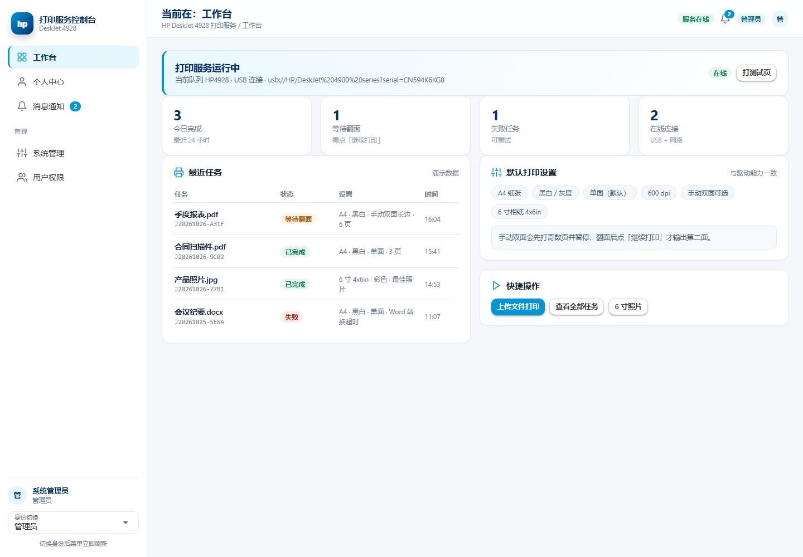
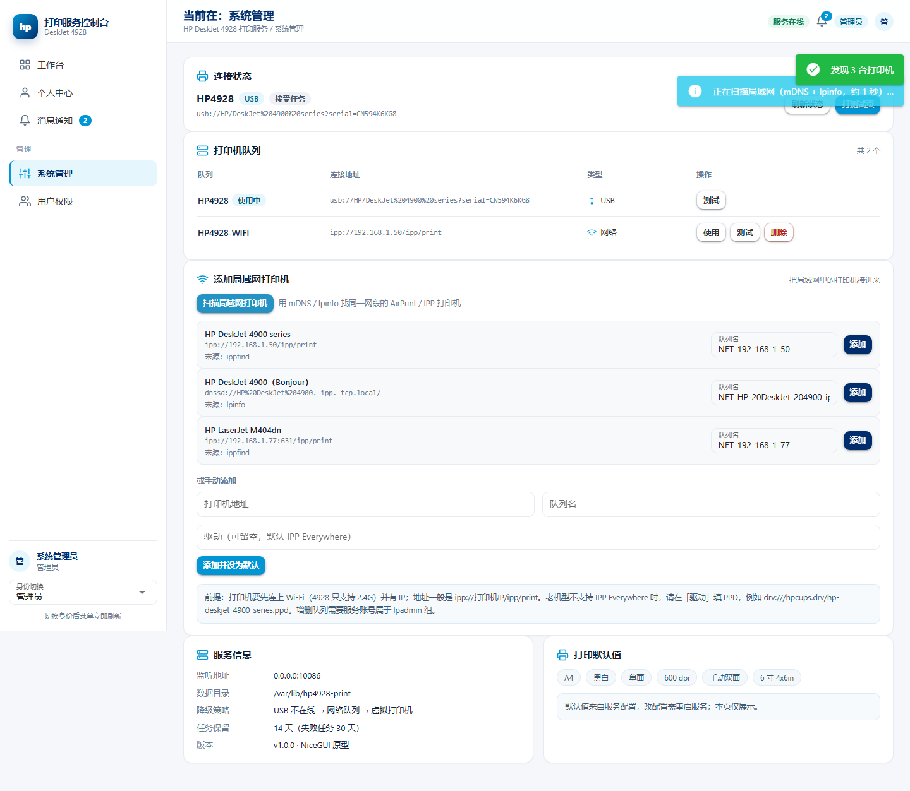
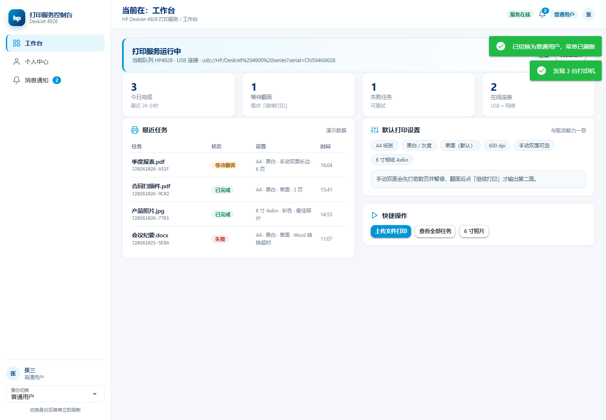
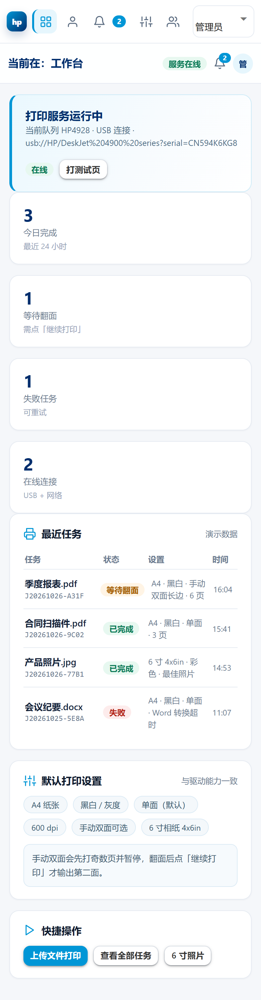

# HP 4928 控制台 · NiceGUI 单文件原型（HP 配色）

按你的技术要求重做的 UI：**单文件、`pip install nicegui` 后 `python app.py` 直接预览**。

```bash
python -m pip install nicegui
python app.py                       # http://127.0.0.1:8080
python app.py --port 9000 --show    # 换端口并自动开浏览器
python app.py --host 0.0.0.0        # 让局域网也能看
```

## 为什么选 NiceGUI 而不是 Streamlit

| | NiceGUI | Streamlit |
| --- | --- | --- |
| 固定侧边栏 + 选中态 | 真 DOM，随便写 CSS | 每次交互整体 rerun，布局会跳 |
| 按角色动态增删菜单 | 清空容器重绘即可 | 依赖 session_state + 条件渲染，闪烁明显 |
| 精确还原 HP 配色/圆角/阴影 | 完全可控 | 受组件主题限制 |
| 异步动作（扫描时转圈） | `async def` 事件处理器 | 靠 `st.spinner` + rerun |

所以用 NiceGUI；它是 Vue/Quasar 之上的一层，页面结构和样式都归你管。

## 设计 token

| 用途 | 色值 |
| --- | --- |
| HP 主蓝（选中条、主按钮） | `#0096D6` |
| HP 深蓝（标题、Logo 渐变） | `#002E6D` |
| 正文文字 | `#333333` |
| 侧边栏背景 | `#FFFFFF` |
| 页面背景 | `#F5F7FA` |
| 分隔线 | `#E6EBF2` |

选中态 = **左侧 3px 主蓝竖条 + `#E6F6FD` 浅蓝底 + 深蓝加粗文字**（你给的两个方案里的第一个；不想要竖条可以只留底色，改 `.hp-nav-item.is-active` 一行即可）。

Logo 是**占位区**：40×40 圆角方块 + 渐变 + `hp` 字样，换成真 logo 只需替换 `.hp-logo-mark` 的内容。

## 页面与权限

| 菜单 | 普通用户 | 管理员 |
| --- | :-: | :-: |
| 工作台 | ✅ | ✅ |
| 个人中心 | ✅ | ✅ |
| 消息通知 | ✅ | ✅ |
| 系统管理 | — | ✅ |
| 用户权限 | — | ✅ |

- 身份切换在**侧边栏底部**的下拉框；切换后菜单立即重绘（管理分组整体出现/消失）
- 如果当前停留在管理员页面时切成普通用户，会自动回到工作台
- 顶部右侧同步显示角色徽标（手机端隐藏，避免挤）
- 主内容区顶部固定显示 `当前在：工作台` 这类标题 + 面包屑

## 系统管理里的「打印机与连接」= 之前那版服务的 Wi-Fi 功能

| 界面能力 | 真实服务对应接口 |
| --- | --- |
| 队列列表（USB / 网络徽标、使用中、启用状态） | `GET /api/printers` |
| 「使用」切换队列 | `POST /api/printers/select` |
| 扫描局域网打印机（ippfind / lpinfo） | `GET /api/printers/discover` |
| 手动添加 `ipp://IP/ipp/print` + 队列名 + 驱动 | `POST /api/printers/add` |
| 打测试页 | `POST /api/printers/test` |
| 删除队列（使用中的拒绝删除） | `DELETE /api/printers/<name>` |

原型里扫描是**模拟**的：点一下转 1 秒，返回 3 条演示设备（含 `ipp://` 和 `dnssd://` 两种），
每条可改队列名后添加；添加后会进入队列表并可切换、打测试页。
下方还保留了手动添加表单和「前提/限制」提示（4928 只支持 2.4G、`everywhere` 需 CUPS ≥ 2.4、
增删队列要 lpadmin 组）。

## 数据说明（重要）

- 数据全在内存里，**刷新页面恢复演示数据**；不会真的调用 CUPS
- 但交互是**真的**：切换身份、切换队列、添加/删除、标记已读、打开消息都会改变界面状态
- 接真实后端见 `app.py` 末尾注释，两个方案：
  1. 把 `STORE` 换成 `httpx.AsyncClient`，直接调上面那张表里的接口（需先 `POST /api/auth/login` 拿 Cookie + `X-CSRF-Token`）
  2. 保留 NiceGUI 做前端，把 `hp4928` 的 `jobs/printers/ppd/docs` 当库直接调用，用 `ui.run` 取代 waitress

## 预览

| 工作台（管理员） | 系统管理 · 扫描局域网 |
| --- | --- |
|  |  |

| 切成普通用户（管理菜单消失） | 手机端 |
| --- | --- |
|  |  |

## 文件

```
ui-prototype/
├── app.py                  # 单文件应用（约 1090 行，含 CSS 与全部页面）
├── README.md
└── preview/                # 上面 4 张截图
```

`app.py` 结构：常量/配色 → 内联 SVG 图标 → 内存数据模型 → CSS → 导航元数据 →
页面（工作台/个人中心/消息通知/系统管理/用户权限）→ 外壳（侧栏+顶栏+内容，负责重绘）→ 入口。
